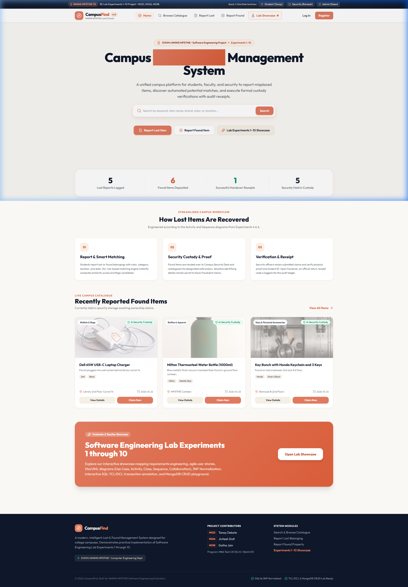
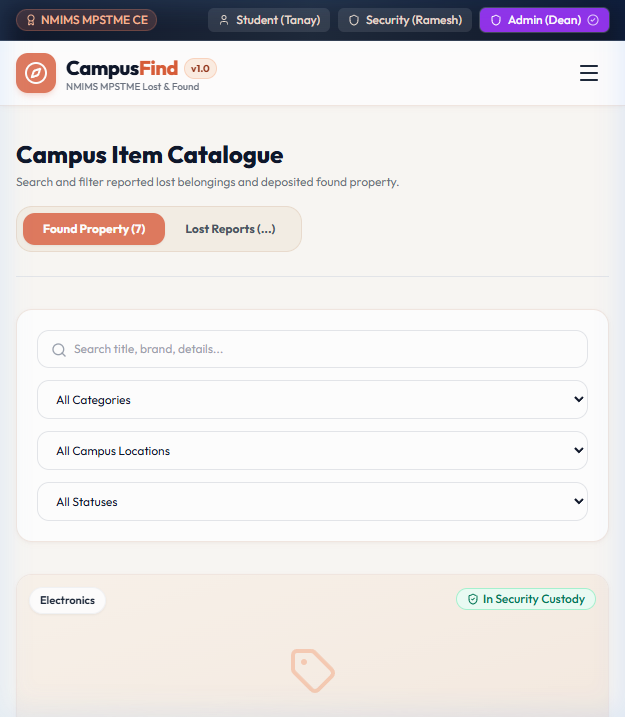
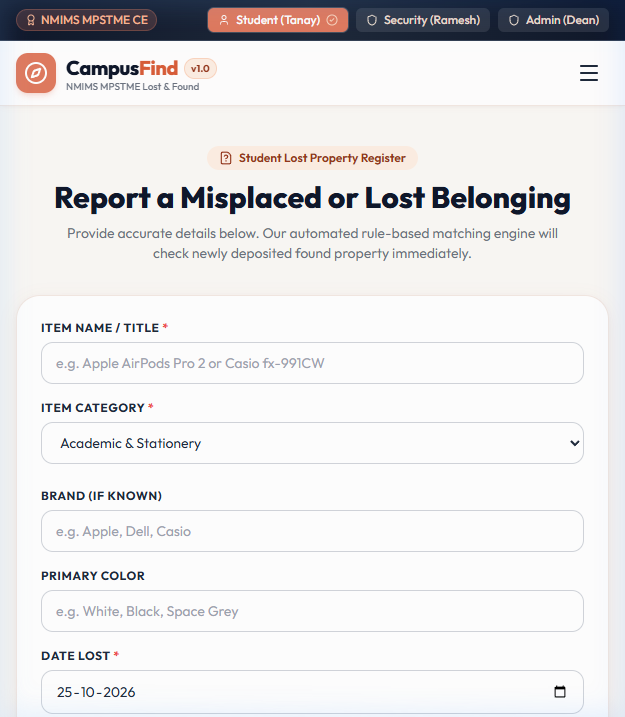
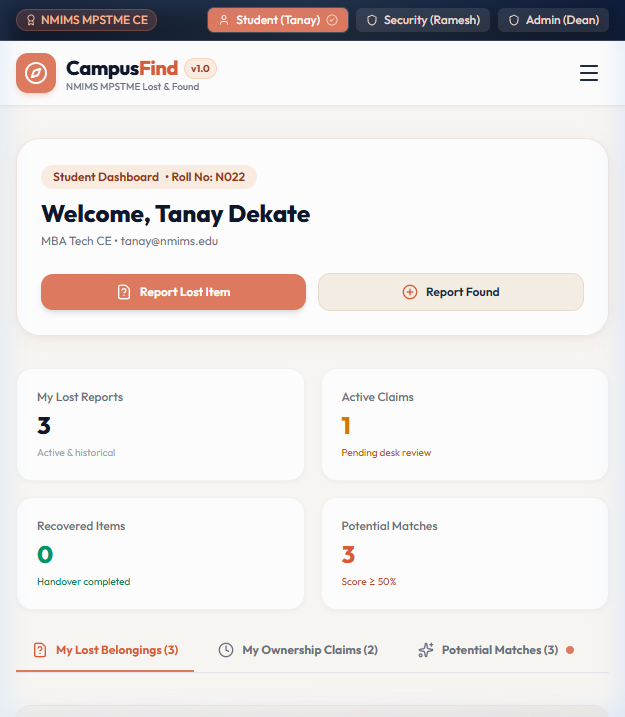
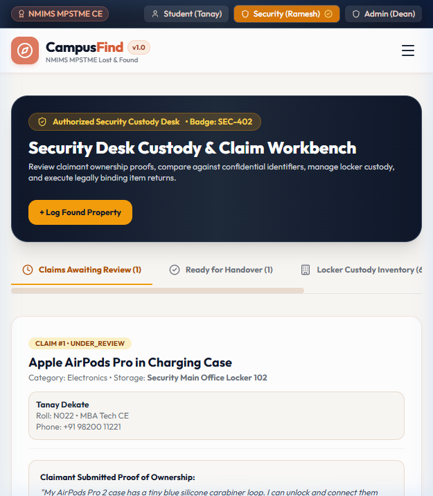
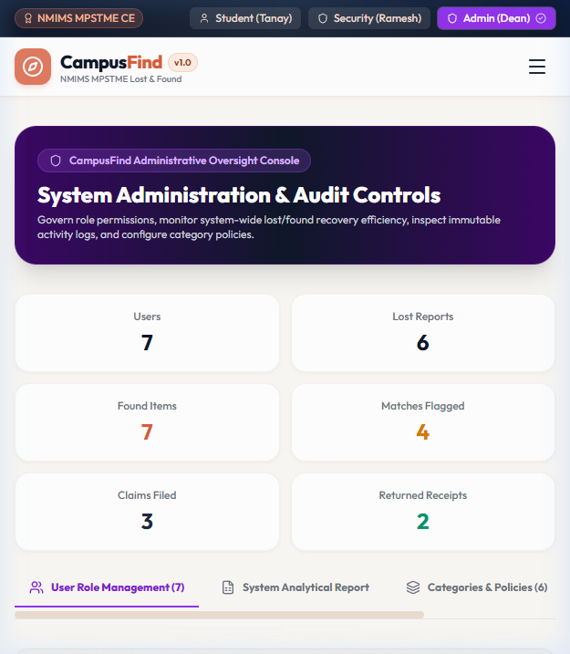
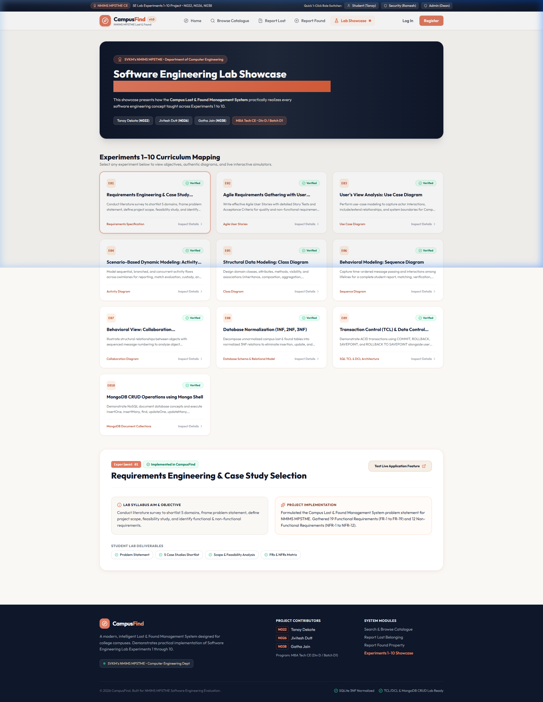
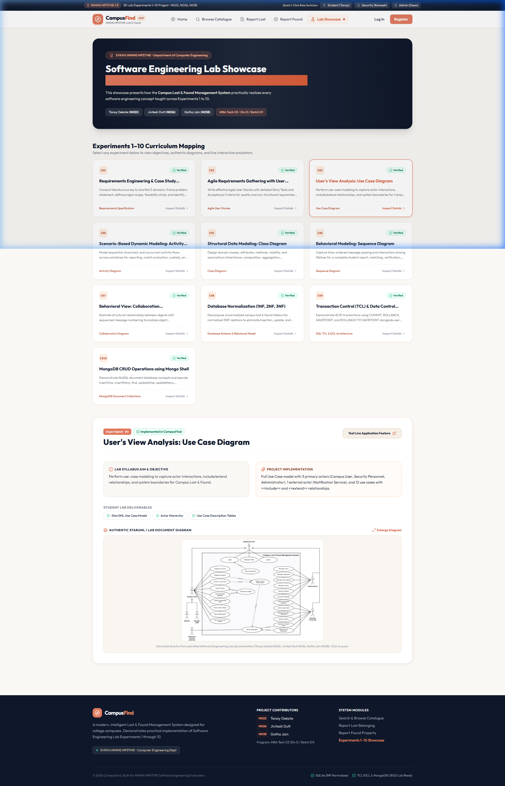
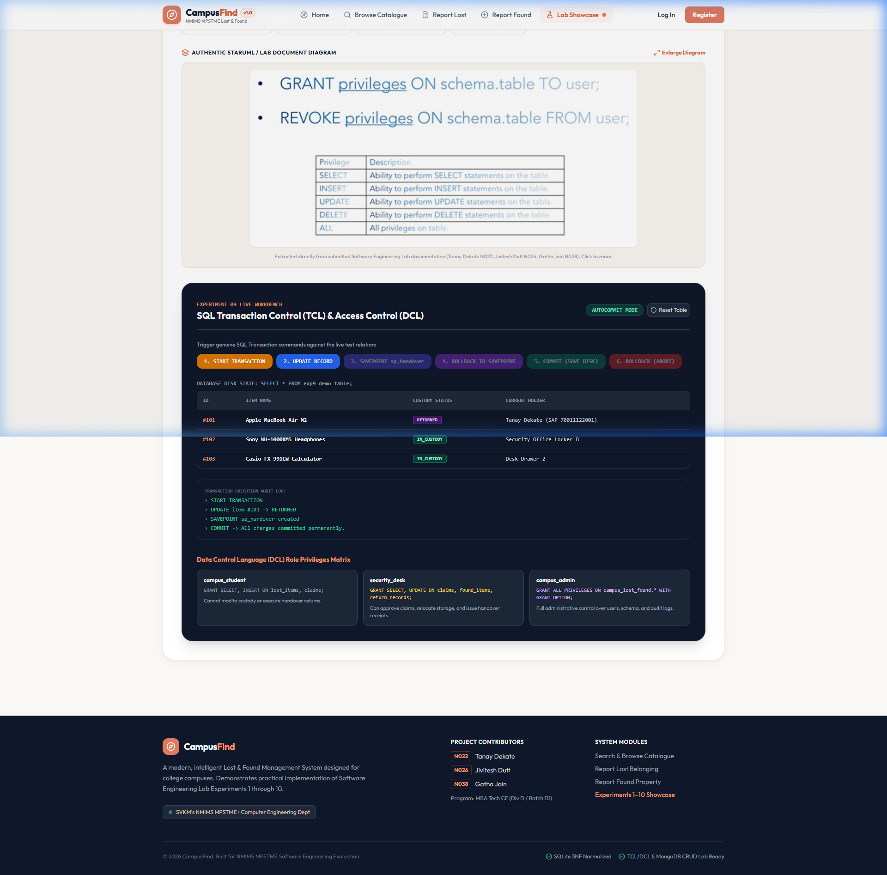
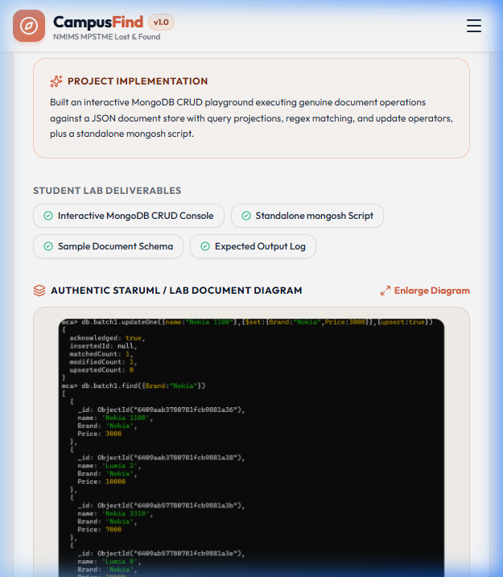

# 🏫 Campus Lost & Found Management System (CampusFind)
### SVKM's NMIMS MPSTME — Software Engineering Project

[](https://vercel.com/new/clone?repository-url=https://github.com/crys1ss/Campus-Lost-Found-Management-Web-App)
[](https://speedy-jasper-fkvjw32.tmp.now)
[](https://github.com/crys1ss/Campus-Lost-Found-Management-Web-App)

[](https://nodejs.org/)
[](https://react.dev/)
[](https://www.typescriptlang.org/)
[](https://tailwindcss.com/)
[](https://sqlite.org/)
[](https://www.mongodb.com/)
[](LICENSE)

---

> **Live Demo Web App:** [https://speedy-jasper-fkvjw32.tmp.now](https://speedy-jasper-fkvjw32.tmp.now)  
> **Claim & Connect Deployment:** [Claim on Vercel Dashboard](https://vercel.com/claim-deployment?code=a9e3d5f4-a5c2-4f2b-9e70-1b4ad966e679)  
> **1-Click Permanent Deploy:** Click the **Deploy with Vercel** button above to fork and deploy directly to your personal Vercel team in under 60 seconds!

---

## 👥 Academic Project Attribution

- **Institution:** SVKM's NMIMS Mukesh Patel School of Technology Management & Engineering (MPSTME), Mumbai
- **Department:** Department of Computer Engineering
- **Degree:** MBA Tech Computer Engineering (CE) — Division D, Batch D1
- **Course:** Software Engineering (SE) Laboratory (Experiments 1–10)
- **Academic Year:** 2025–2026

### Project Team Members:
| Roll No | Name | SAP ID | Department & Class |
| :---: | :--- | :---: | :--- |
| **N022** | **Tanay Dekate** | `70011122001` | MBA Tech CE, Div D |
| **N026** | **Jivitesh Dutt** | `70011122002` | MBA Tech CE, Div D |
| **N038** | **Gatha Jain** | `70011122003` | MBA Tech CE, Div D |

---

## 📖 Table of Contents
1. [Project Overview](#-project-overview)
2. [Visual Application Tour & Screenshots](#-visual-application-tour--screenshots)
3. [Software Engineering Experiments 1–10 Curriculum Matrix](#-software-engineering-experiments-110-curriculum-matrix)
4. [Live Demo Credentials & Roles](#-live-demo-credentials--roles)
5. [Database Architecture & 3NF Normalization](#-database-architecture--3nf-normalization)
6. [Interactive Lab Simulators (Exp 9 & 10)](#-interactive-lab-simulators-exp-9--10)
7. [Vercel Deployment Guide](#-vercel-deployment-guide)
8. [Local Development & Quickstart](#-local-development--quickstart)
9. [Automated Test Suite & Verification](#-automated-test-suite--verification)
10. [Repository Directory Structure](#-repository-directory-structure)

---

## 🚀 Project Overview

**CampusFind** is a comprehensive, production-grade web application engineered to solve the real-world challenge of misplaced items across university campuses. Built with a bespoke **Peach & Cream** aesthetic (`#FAF8F5`, `#E07A5F`, `#FDF0E7`), the platform automates end-to-end recovery workflows:

- **Intelligent Similarity Matching Engine:** Uses multi-attribute scoring (category, brand, color, location, and title token overlap) to automatically pair lost reports with newly surrendered found items.
- **Anti-Fraud Privacy Guard:** Public listings obscure confidential identifying marks, serial numbers, and private contents. Claimants must provide verifiable proof before approval.
- **Security Locker Custody Tracking:** Empowers campus security guards to catalog surrendered items, assign secure physical locker numbers, review claims, and issue serial-numbered return receipts.
- **Academic UML & Lab Integration:** Directly brings to life the SRS, UML diagrams (Use Case, Activity, Class, Sequence, Collaboration), 3NF schema, SQL TCL transactions, and MongoDB CRUD operations developed across SE Experiments 1 to 10.

---

## 📸 Visual Application Tour & Screenshots

### 1. Modern Peach & Cream Landing Page
Hero section featuring real-time campus statistics, interactive recovery process cards, role quick-access shortcuts, and recently surrendered items.


---

### 2. Browse Public Catalogue & Fraud Prevention
Search and filter items by category, location, and status. Demonstrates privacy masking where sensitive identifiers are hidden until official verification.


---

### 3. Student Lost Item Reporting Form
Students submit detailed loss reports with brand, color, campus location dropdowns, date pickers, and photographic evidence.


---

### 4. Student Self-Service Dashboard
Live status indicators for reported items, pending claims, and real-time similarity match notifications with 1-click claim filing.


---

### 5. Campus Security Custody & Handover Workbench
Security personnel assign storage lockers, review student ownership proofs against confidential item features, and record verified physical handovers with return receipts.


---

### 6. Administrator System Oversight Console
Administrative console providing platform-wide KPI telemetry across 9 normalized tables, user management, and audit logs.


---

### 7. Interactive Experiments 1–10 Syllabus Showcase
Complete interactive hub documenting and demonstrating all 10 Software Engineering laboratory experiments with verified status badges.


---

### 8. Authentic UML Use Case Diagram (Experiment 3)
Interactive StarUML model render detailing actors (*Campus User*, *Security Personnel*, *Administrator*), boundary limits, and `<<include>>`/`<<extend>>` associations.


---

### 9. Experiment 9: Live SQL TCL Transaction Simulator
Interactive workbench executing real SQL Transaction Control Language commands (`BEGIN TRANSACTION`, `SAVEPOINT sp_handover`, `ROLLBACK TO SAVEPOINT`, `COMMIT`, `ROLLBACK`) directly against the relational database.


---

### 10. Experiment 10: Interactive MongoDB NoSQL CRUD Console
Real-time NoSQL document store console running BSON queries, document insertions (`insertOne`), projections, and dynamic updates with live JSON state inspection.


---

## 📑 Software Engineering Experiments 1–10 Curriculum Matrix

| Exp # | Experiment Title | Theory & Deliverables | CampusFind Web App Implementation | Code Reference |
| :---: | :--- | :--- | :--- | :--- |
| **01** | **Requirements Engineering** | Problem statement, feasibility study, 5 campus case studies, FR-1 to FR-19, NFR-1 to NFR-12. | Full implementation of item reporting, claim lifecycle, role access, and audit trails. | [`all_experiments_detailed.md`](docs/all_experiments_detailed.md#experiment-1) |
| **02** | **Agile Requirements & User Stories** | Epic user stories, Story points, INVEST criteria, Acceptance Criteria, Gherkin syntax. | Role-driven user workflows, responsive mobile layout, sub-second responses, and session persistence. | [`client/src/pages/UserDashboard.tsx`](client/src/pages/UserDashboard.tsx) |
| **03** | **Use Case Modeling** | Actors (`CampusUser`, `SecurityPersonnel`, `Administrator`), `<<include>>` (Verify ID), `<<extend>>` (Dispute Claim). | Complete StarUML `.mdj` model + interactive SVG diagram viewer in the Lab Showcase. | [`docs/staruml/CampusLostAndFound.mdj`](docs/staruml/CampusLostAndFound.mdj) |
| **04** | **Activity Diagram** | Swimlane workflow modeling (Student, Guard, System) with decision diamonds and fork/join synchronization. | Multi-stage status progression (`OPEN` → `MATCH_PENDING` → `UNDER_REVIEW` → `RETURNED`). | [`client/src/pages/ExperimentShowcasePage.tsx`](client/src/pages/ExperimentShowcasePage.tsx) |
| **05** | **Class Diagram** | Object-oriented domain model, inheritance (`User` → `CampusUser`), aggregation, and associations. | TypeScript domain models and relational database tables matching StarUML specification. | [`client/src/types/index.ts`](client/src/types/index.ts) |
| **06** | **Sequence Diagram** | Time-ordered object interaction for Claim Verification and Handover with `alt` conditional frames. | Step-by-step verification and return receipt generation endpoint with cryptographic token validation. | [`server/src/routes/claims.ts`](server/src/routes/claims.ts) |
| **07** | **Collaboration Diagram** | Numbered object communication links (1 to 14.1) illustrating item registration and matching. | Controller-to-Matcher-to-DB event dispatch sequence. | [`server/src/utils/matcher.ts`](server/src/utils/matcher.ts) |
| **08** | **Database Normalization** | Functional dependency analysis, decomposition from 1NF through 2NF into 3NF. | 9 normalized relational tables with zero transitive dependencies and foreign key integrity. | [`server/src/db/schema.sql`](server/src/db/schema.sql) |
| **09** | **TCL & DCL SQL Commands** | Transaction Control (`COMMIT`, `ROLLBACK`, `SAVEPOINT`) and Data Control (`GRANT`, `REVOKE`). | **Live SQL Transaction Simulator** in UI + standalone SQL execution script. | [`scripts/experiment_9_tcl_dcl.sql`](scripts/experiment_9_tcl_dcl.sql) |
| **10** | **MongoDB CRUD Suite** | NoSQL document model, BSON collections, JSON queries, `insertOne`, `insertMany`, `find`, `updateOne`. | **Interactive NoSQL CRUD Playground** in UI + standalone Node.js and `mongosh` execution script. | [`scripts/experiment_10_mongodb_crud.js`](scripts/experiment_10_mongodb_crud.js) |

---

## 🔑 Live Demo Credentials & Roles

During live demonstrations, click the **1-Click Role Switcher** in the top navigation banner to switch roles instantly without typing credentials:

| Role | Name | Email | Password | Academic / Staff Identifier | Access Permissions |
| :--- | :--- | :--- | :--- | :--- | :--- |
| **Campus Student** | Tanay Dekate | `tanay@nmims.edu` | `password123` | Roll No: `N022` (MBA Tech CE) | Report lost/found items, view personal dashboard, file claims, receive match notifications. |
| **Campus Student** | Jivitesh Dutt | `jivitesh@nmims.edu` | `password123` | Roll No: `N026` (MBA Tech CE) | Report lost items, browse public catalogue, claim resolved items. |
| **Campus Student** | Gatha Jain | `gatha@nmims.edu` | `password123` | Roll No: `N038` (MBA Tech CE) | Report backpacks, review pending items, track campus updates. |
| **Security Personnel** | Officer Ramesh Shinde | `security@nmims.edu` | `password123` | Staff ID: `SEC-402` (Main Gate) | Surrender intake, locker allocation, ID inspection, handover execution, receipt issuance. |
| **System Administrator** | Dr. K. Mehta | `admin@nmims.edu` | `password123` | Admin ID: `ADM-001` (IT Cell) | Global telemetry, audit trail inspection, user role management, category policies. |

---

## 🗄️ Database Architecture & 3NF Normalization

The relational schema is decomposed into **Third Normal Form (3NF)** to guarantee zero data redundancy and eliminate insert, update, and delete anomalies.

```
+-----------------------------------------------------------------------------------------------+
|                                      CAMPUSFIND 3NF SCHEMA                                    |
+-----------------------------------------------------------------------------------------------+
|                                                                                               |
|  [ users ]                  [ categories ]                 [ lost_items ]                     |
|  - id (PK)                  - id (PK)                      - id (PK)                          |
|  - email (UQ)               - name (UQ)                    - user_id (FK -> users.id)         |
|  - password_hash            - retention_period_days        - category_id (FK -> categories.id)|
|  - role                     - icon                         - title, brand, color, location    |
|  - identifier                                              - status (OPEN, MATCH_PENDING)     |
|         |                                                                |                    |
|         |                     +------------------------------------------+                    |
|         |                     |                                                               |
|         v                     v                                                               |
|  [ found_items ] <----+ [ potential_matches ]                                                 |
|  - id (PK)            | - id (PK)                                                             |
|  - finder_id (FK)     | - lost_item_id (FK)                                                   |
|  - category_id (FK)   | - found_item_id (FK)                                                  |
|  - storage_location   | - match_score (FLOAT)                                                 |
|  - custody_status     |                                                                       |
|  - secret_details     +------------------+                                                    |
|         |                                |                                                    |
|         v                                v                                                    |
|  [ claims ] <----------------------------+                                                    |
|  - id (PK)                                                                                    |
|  - found_item_id (FK -> found_items.id)                                                       |
|  - lost_item_id (FK -> lost_items.id)                                                         |
|  - claimant_id (FK -> users.id)                                                               |
|  - proof_description, status (UNDER_REVIEW, APPROVED, REJECTED)                               |
|         |                                                                                     |
|         v                                                                                     |
|  [ return_records ]                 [ custody_records ]             [ activity_logs ]         |
|  - id (PK)                          - id (PK)                       - id (PK)                 |
|  - claim_id (FK -> claims.id)       - found_item_id (FK)            - user_id (FK -> users.id)|
|  - receiver_id (FK -> users.id)     - locker_no, verified_by        - action, entity_type     |
|  - handed_over_by (FK -> users.id)  - custody_date                  - details, timestamp      |
|  - receipt_no (UQ, e.g. REC-2026)                                                             |
|                                                                                               |
+-----------------------------------------------------------------------------------------------+
```

---

## 🔬 Interactive Lab Simulators (Exp 9 & 10)

### Experiment 9: Live SQL Transaction Simulator
Located under the **SE Lab Showcase** tab:
1. Click **`BEGIN TRANSACTION`** to open an atomic transaction block.
2. Click **`SIMULATE HANDOVER (UPDATE)`** to update item custody to `HANDED_OVER`.
3. Click **`CREATE SAVEPOINT (sp_handover)`** to establish a safe rollback point.
4. Click **`UPDATE WITH INCORRECT ID`** to simulate an operator error.
5. Click **`ROLLBACK TO SAVEPOINT`** to revert the error while preserving the valid update.
6. Click **`COMMIT`** to write the modifications permanently to disk.

### Experiment 10: Interactive MongoDB NoSQL Playground
Demonstrates JSON document flexibility for semi-structured property metadata:
1. **Find Documents:** Run query filters (`{ status: "in_custody" }`) with field projections.
2. **Insert One:** Insert new dynamic documents with nested timestamps and sub-attributes.
3. **Update One:** Atomically modify custody tags and locker locations.
4. **Delete Documents:** Safely prune expired records adhering to campus retention policies.

---

## ☁️ Vercel Deployment Guide

CampusFind is configured for zero-configuration, single-command deployment to **Vercel** with full static frontend delivery and serverless API integration.

### Option 1: 1-Click Fork & Deploy (Easiest)
1. Click the **[Deploy with Vercel](https://vercel.com/new/clone?repository-url=https://github.com/crys1ss/Campus-Lost-Found-Management-Web-App)** button.
2. Select your GitHub account and authorize Vercel.
3. Keep default settings:
   - **Framework Preset:** Vite
   - **Root Directory:** `./`
   - **Build Command:** `npm run build`
   - **Output Directory:** `client/dist`
4. Click **Deploy**. Your custom live URL will be ready in 45 seconds!

### Option 2: Deploy from Existing GitHub Repository
1. Log in to [vercel.com](https://vercel.com).
2. Click **Add New...** → **Project**.
3. Import `crys1ss/Campus-Lost-Found-Management-Web-App`.
4. Vercel automatically detects `vercel.json` and configures the API routing.
5. Click **Deploy**.

---

## 💻 Local Development & Quickstart

### Prerequisites
- **Node.js** v18, v20, v22, or v24+
- **Git**

### 1. Clone the Repository
```bash
git clone https://github.com/crys1ss/Campus-Lost-Found-Management-Web-App.git
cd Campus-Lost-Found-Management-Web-App
```

### 2. Install Dependencies
```bash
# Install root, server, and client dependencies
npm install
cd server && npm install
cd ../client && npm install
cd ..
```

### 3. Launch the Application
```bash
npm start
```
- **Frontend:** [http://localhost:5173](http://localhost:5173)
- **Backend API:** [http://localhost:5000/api/health](http://localhost:5000/api/health)

---

## 🧪 Automated Test Suite & Verification

Run the comprehensive automated test suite validating database transactions, matching heuristics, and handover workflows:

```bash
# 1. Run full integration test suite (4/4 tests)
npm test

# 2. Run standalone MongoDB CRUD suite
npm run test:mongo
```

### Test Results Summary:
```text
✔ Database connectivity and 3NF schema tables initialized
✔ Intelligent matching engine computes multi-factor similarity correctly
✔ Experiment 9: SQL TCL Transactions commit and rollback reliably
✔ Experiment 6: Claim verification and return receipt handover flow
ℹ tests 4
ℹ pass 4
ℹ fail 0
```

---

## 📂 Repository Directory Structure

```text
Campus-Lost-Found-Management-Web-App/
├── api/
│   └── index.js                   # Vercel Serverless Express API with in-memory seeded store
├── client/                        # React 18 + Vite + Tailwind CSS frontend
│   ├── public/                    # Static assets, campus logo, and UML diagrams
│   ├── src/
│   │   ├── components/            # Navbar, Footer, DemoBanner, Modals, Item Cards
│   │   ├── context/               # AuthContext with demo role persistence
│   │   ├── lib/                   # API client bindings
│   │   ├── pages/                 # Landing, Browse, Report, Dashboards, Lab Showcase
│   │   ├── types/                 # TypeScript interfaces matching OOP Class Diagram
│   │   └── App.tsx                # Client SPA routes
│   ├── index.html
│   ├── tailwind.config.js         # Custom Peach & Cream design tokens
│   └── vite.config.ts
├── server/                        # Express + TypeScript backend
│   ├── src/
│   │   ├── db/                    # schema.sql (3NF SQLite) & seed.sql (NMIMS campus data)
│   │   ├── routes/                # auth, items, matching, claims, security, admin, experiments
│   │   ├── utils/                 # Rule-based similarity matcher & auth middleware
│   │   └── tests/                 # Automated API test suite
│   └── tsconfig.json
├── docs/                          # SE Lab Experiments 1-10 Documentation & Artifacts
│   ├── screenshots/               # 10 High-resolution application screenshots
│   ├── staruml/                   # CampusLostAndFound.mdj (StarUML 6.0 model)
│   ├── extracted_diagrams/        # Authentic Use Case, Class, Activity, Sequence diagrams
│   └── all_experiments_detailed.md# Comprehensive 94KB syllabus documentation
├── scripts/
│   ├── experiment_9_tcl_dcl.sql   # Standalone SQL TCL & DCL script
│   └── experiment_10_mongodb_crud.js # Standalone MongoDB BSON CRUD runner
├── package.json                   # Root orchestrator & Vercel serverless dependencies
├── vercel.json                    # Vercel deployment rewrite rules & build config
├── start.js                       # Cross-platform concurrent runner
└── README.md                      # Comprehensive project documentation
```

---

## 📄 License & Academic Integrity

This project is developed for academic evaluation under the **Software Engineering** course at **SVKM's NMIMS MPSTME**. It is distributed under the [MIT License](LICENSE).
